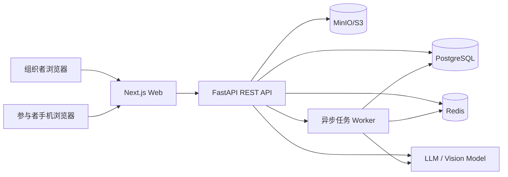
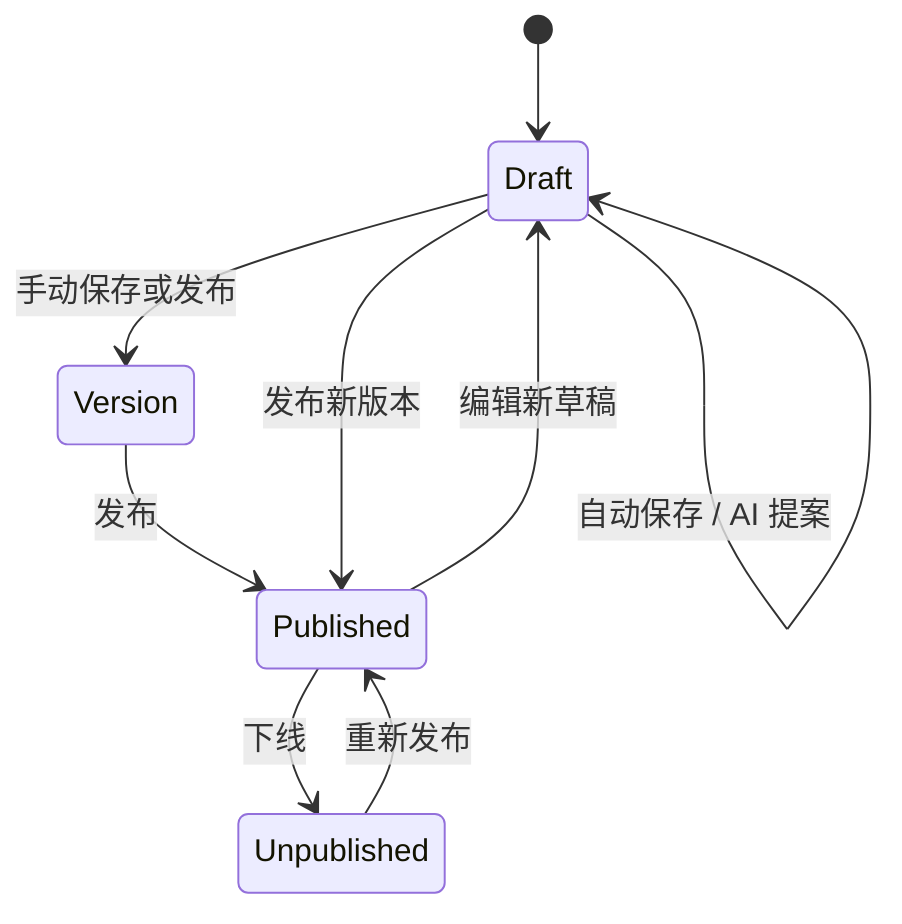
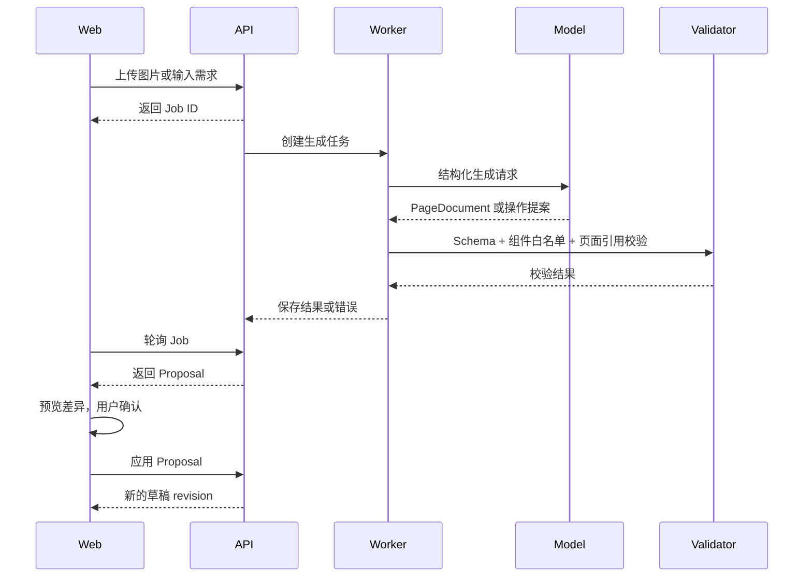

# 系统架构与关键决策

## 1. 架构目标

V1 需要同时满足三个目标：

1. 编辑态足够灵活，支持多页面、拖拽和 AI 建议。
2. 发布态足够稳定，参与者访问的是冻结版本而不是实时草稿。
3. AI 输出足够可控，所有自动修改都能校验、解释、确认和撤销。

## 2. 总体架构



### 主要服务

| 服务 | 职责 |
|---|---|
| Web | 一个 Next.js 工程；电脑端提供工作台和编辑器，移动端提供公共活动页 |
| API | 鉴权、项目、草稿、版本、发布、提交、AI 编排 |
| Worker | 海报解析、整页生成、质量检查、导出等耗时任务 |
| PostgreSQL | 业务数据、页面文档、提交记录、AI 审计记录 |
| Redis | 缓存、接口限流、异步任务队列 |
| MinIO/S3 | 海报、页面图片和导出文件 |
| LLM/Vision | 文本生成、图片信息提取、修改建议 |

## 3. 代码仓库建议

建议使用一个 Monorepo，便于共享协议和类型：

```text
apps/
├── web/                  # Next.js
├── api/                  # FastAPI
└── worker/               # 异步任务入口，可与 api 共用 Python 包
packages/
├── page-schema/          # PageDocument JSON Schema、示例和校验器
├── component-schema/     # 组件白名单与属性约束
└── api-client/           # 从 OpenAPI 生成的 TypeScript 客户端
infra/
├── docker-compose.yml
└── migrations/
```

如果时间紧张，可以先使用两个仓库：`web` 和 `server`。但 PageDocument 的 JSON Schema 必须只维护一份。

`web` 内部不再拆分两套独立应用。电脑端与移动端通过不同路由和页面外壳复用同一个组件渲染器；公共活动路由不得加载 dnd-kit、编辑侧栏等组织者代码。

## 4. 关键领域模型

### Project

活动项目，拥有标题、所有者、草稿、发布设置和提交数据。

### PageDocument

编辑器唯一承认的页面结构，包含页面、组件、主题和导航关系。AI、模板、编辑器、预览器都读写这一结构。

### PageVersion

项目在某个时刻的不可变 PageDocument 快照。发布操作只能选择一个已保存版本。

### AI Proposal

AI 返回的修改计划，包含原因、目标和可执行操作。Proposal 不是已应用状态。

### Public Activity

通过公开 slug 访问的已发布活动。只读取发布版本，不暴露未发布内容。

### Submission

参与者提交的表单数据，必须绑定项目、发布版本和表单页面。

## 5. PageDocument 统一契约

V1 推荐结构：

```json
{
  "schemaVersion": "1.0",
  "title": "摄影社 2026 秋季招新",
  "homePageId": "page_home",
  "theme": {
    "primaryColor": "#2457D6",
    "backgroundColor": "#F6F8FC",
    "textColor": "#172033",
    "radius": 16,
    "fontScale": 1
  },
  "pages": [
    {
      "id": "page_home",
      "title": "首页",
      "path": "home",
      "components": [
        {
          "id": "cmp_banner",
          "type": "banner",
          "props": {
            "imageUrl": "https://assets.example.com/banner.jpg",
            "height": 220
          }
        },
        {
          "id": "cmp_submit",
          "type": "button",
          "props": {
            "text": "立即报名",
            "action": {
              "type": "navigate",
              "pageId": "page_form"
            }
          }
        }
      ]
    }
  ]
}
```

约束：

- 组件 `id` 和页面 `id` 在文档内唯一。
- 组件 `type` 必须来自白名单。
- 组件属性由对应 JSON Schema 校验，未知属性应拒绝或丢弃。
- 页面只能通过按钮动作形成导航关系。
- 远程资源 URL 必须来自受信任存储或通过 URL 校验。
- 不允许出现脚本字段、内联事件和任意 HTML。

## 6. 编辑与发布状态



关键规则：

- 编辑器修改 `projects.draft_document`。
- 每次自动保存增加 `draft_revision`，使用乐观锁防止覆盖。
- AI 只生成 Proposal；用户确认后由后端应用成新的草稿 revision。
- 发布时将草稿复制成不可变 PageVersion，并更新 `published_version_id`。
- 参与者只读取发布版本。
- 编辑已发布项目时，线上版本保持不变，直到用户重新发布。

## 7. AI 处理链路



## 8. 安全边界

- 所有项目、素材、版本和提交记录必须按 `owner_id` 做资源级授权。
- 公共活动 API 不返回项目内部 ID、AI 记录、其他提交或草稿。
- 公共 slug 使用不可预测随机值，并提供限流。
- 上传图片检查 MIME、扩展名、文件头和大小，必要时重新编码去除恶意载荷。
- AI 生成或建议的内容一律视为不可信输入，必须经过组件 Schema 校验。
- 表单提交按字段定义白名单过滤，不接受任意 JSON。
- AI 对话内容不能直接执行系统命令、SQL、HTTP 请求或前端脚本。
- 日志中不记录密码、令牌、完整手机号、完整表单答案和模型密钥。
- 导出文件使用短期签名 URL，并检查请求者是否为项目所有者。

## 9. 可观测性

每个 AI Job 至少记录：

- Job 类型和状态
- 输入摘要，不记录敏感全文
- 使用的模型与提示模板版本
- 耗时和错误码
- Schema 校验结果
- Token 用量或供应商计费字段，如可获取
- Proposal 是否被应用、拒绝或撤销

业务指标建议：

- 生成成功率
- Schema 一次通过率
- AI 建议采纳率
- 平均建议应用次数
- 从创建到发布的耗时
- 发布活动提交数

## 10. 非目标

V1 不实现原生小程序运行时、通用自由画布、多人实时协作、在线支付、AI 视频、复杂权限审批和自定义域名。

