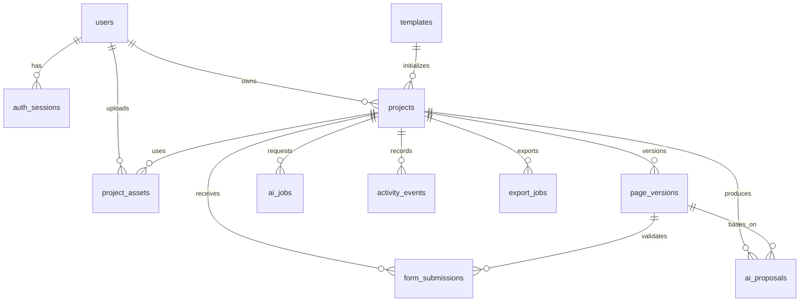

# 数据库设计

## 1. 技术选择

- PostgreSQL 16
- UUID 主键
- `JSONB` 保存 PageDocument、AI 输入输出和表单答案
- `TIMESTAMPTZ` 保存时间
- 应用层进行资源授权和字段级表单校验

真实 DDL 位于 [`sql/001_init.sql`](../sql/001_init.sql)。本文件解释实体关系与设计原因。

## 2. 实体关系



## 3. 核心表

### `users`

| 字段 | 类型 | 说明 |
|---|---|---|
| `id` | UUID | 主键 |
| `email` | CITEXT | 唯一登录邮箱 |
| `password_hash` | TEXT | Argon2id 或 bcrypt 哈希 |
| `display_name` | VARCHAR(80) | 显示名 |
| `status` | VARCHAR(20) | active/disabled |
| `created_at` | TIMESTAMPTZ | 创建时间 |
| `updated_at` | TIMESTAMPTZ | 更新时间 |

### `templates`

| 字段 | 类型 | 说明 |
|---|---|---|
| `id` | UUID | 主键 |
| `code` | VARCHAR(60) | 稳定模板编码 |
| `name` | VARCHAR(120) | 模板名称 |
| `category` | VARCHAR(40) | recruitment/registration/vote/checkin |
| `document` | JSONB | 模板 PageDocument |
| `cover_url` | TEXT | 模板封面 |
| `is_active` | BOOLEAN | 是否可用 |

### `projects`

| 字段 | 类型 | 说明 |
|---|---|---|
| `id` | UUID | 主键 |
| `owner_id` | UUID | 所有者 |
| `template_id` | UUID | 来源模板，可空 |
| `title` | VARCHAR(160) | 项目名称 |
| `description` | TEXT | 可选说明 |
| `status` | VARCHAR(20) | draft/published/unpublished/archived |
| `draft_document` | JSONB | 当前编辑草稿 |
| `draft_revision` | BIGINT | 乐观锁版本 |
| `public_slug` | VARCHAR(80) | 对外访问标识 |
| `published_version_id` | UUID | 当前发布版本 |
| `publish_settings` | JSONB | 开放时间、人数等 |
| `deleted_at` | TIMESTAMPTZ | 软删除 |

### `page_versions`

| 字段 | 类型 | 说明 |
|---|---|---|
| `id` | UUID | 主键 |
| `project_id` | UUID | 所属项目 |
| `version_no` | INTEGER | 项目内递增版本号 |
| `document` | JSONB | 不可变页面快照 |
| `source` | VARCHAR(30) | manual/ai/template |
| `created_by` | UUID | 创建者 |
| `created_at` | TIMESTAMPTZ | 创建时间 |

项目内 `(project_id, version_no)` 唯一。

### `project_assets`

| 字段 | 类型 | 说明 |
|---|---|---|
| `id` | UUID | 主键 |
| `owner_id` | UUID | 上传用户 |
| `project_id` | UUID | 可空，创建项目前也可上传 |
| `object_key` | TEXT | 存储对象键 |
| `mime_type` | VARCHAR(100) | 文件类型 |
| `size_bytes` | BIGINT | 文件大小 |
| `sha256` | CHAR(64) | 内容摘要 |
| `width` / `height` | INTEGER | 图片尺寸 |
| `status` | VARCHAR(20) | pending/ready/rejected |

### `form_submissions`

| 字段 | 类型 | 说明 |
|---|---|---|
| `id` | UUID | 主键 |
| `project_id` | UUID | 项目 |
| `version_id` | UUID | 使用的发布版本 |
| `page_id` | VARCHAR(80) | PageDocument 内的页面 ID |
| `form_component_id` | VARCHAR(80) | 表单组件 ID |
| `answers` | JSONB | 已校验的字段答案 |
| `idempotency_key` | UUID | 防重复提交 |
| `submitter_hash` | TEXT | 可选设备/网络摘要，不保存原始 IP |
| `status` | VARCHAR(20) | valid/invalid |
| `submitted_at` | TIMESTAMPTZ | 提交时间 |

唯一约束：`(project_id, idempotency_key)`。

### `ai_jobs`

| 字段 | 类型 | 说明 |
|---|---|---|
| `id` | UUID | 主键 |
| `project_id` | UUID | 项目 |
| `user_id` | UUID | 发起用户 |
| `kind` | VARCHAR(40) | 生成/建议/质检 |
| `status` | VARCHAR(20) | queued/running/succeeded/failed/cancelled |
| `input_payload` | JSONB | 脱敏后的输入 |
| `result_payload` | JSONB | Job 结果摘要 |
| `model_provider` | VARCHAR(60) | 模型供应商 |
| `model_name` | VARCHAR(100) | 模型名称 |
| `error_code` | VARCHAR(80) | 错误码 |
| `error_message` | TEXT | 脱敏错误 |
| `started_at` | TIMESTAMPTZ | 开始时间 |
| `finished_at` | TIMESTAMPTZ | 完成时间 |

### `ai_proposals`

| 字段 | 类型 | 说明 |
|---|---|---|
| `id` | UUID | 主键 |
| `job_id` | UUID | 来源 Job |
| `project_id` | UUID | 项目 |
| `base_revision` | BIGINT | 基于的草稿 revision |
| `target` | JSONB | 页面或组件定位 |
| `summary` | TEXT | 用户可见摘要 |
| `operations` | JSONB | 受控工具列表 |
| `rationale` | JSONB | 建议原因 |
| `risk` | VARCHAR(20) | low/medium/high |
| `status` | VARCHAR(20) | proposed/applied/rejected/stale |
| `applied_revision` | BIGINT | 应用后的 revision |
| `created_at` | TIMESTAMPTZ | 创建时间 |

### `activity_events`

用于访问和提交漏斗统计：

```text
public_page_view
form_started
form_submitted
submission_succeeded
submission_rejected
```

metadata 中只保存非敏感的统计字段。

### `export_jobs`

保存 CSV 导出任务、状态、对象键和过期时间。导出文件只通过短期签名 URL 下载。

## 4. JSONB 使用原则

适合放入 JSONB：

- 快速迭代的 PageDocument
- 表单字段定义
- Proposal 操作
- 已校验的提交答案
- 发布设置

不应放入 JSONB：

- 用户身份和权限主体
- 项目所有者
- 状态机主状态
- 需要跨项目统计的主键字段

## 5. 索引

建议索引：

- `projects(owner_id, deleted_at, updated_at DESC)`
- `projects(public_slug) WHERE public_slug IS NOT NULL`
- `page_versions(project_id, version_no DESC)`
- `form_submissions(project_id, submitted_at DESC)`
- `form_submissions(project_id, status)`
- `ai_jobs(user_id, created_at DESC)`
- `ai_proposals(project_id, status, created_at DESC)`
- `activity_events(project_id, event_type, occurred_at DESC)`

如需按表单字段频繁统计，可以后续增加生成列或汇总表，V1 先由应用读取 JSONB 并控制数据集大小。

## 6. 数据保留与删除

- 删除项目默认软删除，30 天后清理。
- 用户可立即申请彻底删除项目及提交数据。
- 导出文件 24 小时后过期。
- AI 原始上传图片与 Proposal 按产品隐私策略保留，默认不超过 90 天。
- 生产环境必须提供隐私说明和删除入口。

## 7. 数据库约束

应用层和数据库层都要校验：

- 邮箱唯一
- slug 唯一
- 版本号项目内唯一
- 项目所有者不可为空
- 提交必须引用同项目版本
- revision 非负
- 状态字段受 CHECK 约束

数据库 DDL 中对 JSON 内部结构无法完整约束的部分，由后端 PageDocument Schema 和表单 Schema 完成。

